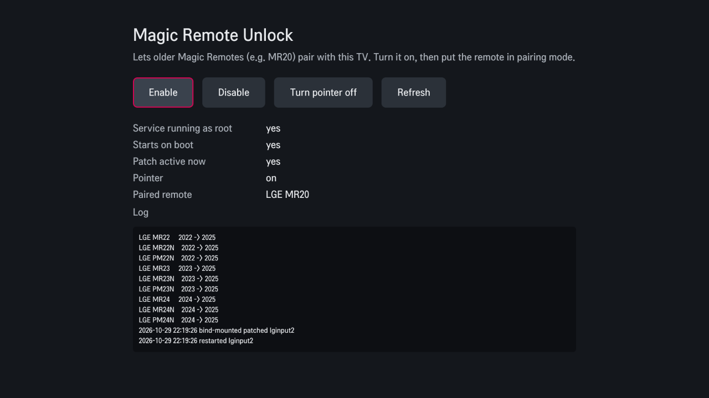

# magic-remote-unlock



Use an older LG Magic Remote, like the MR20, on a 2025 webOS TV via Bluetooth.
Get full functionality of the Magic Remote like voice control and typing, pointer, scrolling and high responsiveness.

Tested on one TV (C5, webOS 10.3.1) with one remote (MR20). See [Other remotes](#other-remotes).

## Background

The Magic Remote service on newer LG TVs, `/usr/sbin/lginput2`, keeps a table of remote names and the year each one came out, and it refuses anything older than the TV's "support start year". On 2025 sets that year is 2025. The log on the TV says so directly (`/tmp/var/log/dbg-log`):

```
remote Support Start Year: 2025
[lginput_util_isNewYearRemote] Fail: LGE MR20 is old mrcu! (2020)
Only specific Magic Remote model can be paired.
```

## What this does

At boot it copies the TV's own `lginput2` to `/tmp`, raises the year of every older Bluetooth Magic Remote in its table (MR18 through MR24 and their PM variants) to the newest year the table knows, bind-mounts the copy over `/usr/sbin/lginput2` and restarts the service. There is nothing to configure.

- Optional **pointer off** switch (in the app): keeps the remote connected over Bluetooth but hides the on-screen pointer and ignores the wheel, so menus use the arrow keys. Buttons are untouched. It's off by default, so the pointer works as normal until you turn it off.
- The system partition is never written to. Reboot without the script and the TV is stock again.
- No LG binary is included here. The patch is applied to your TV's own file, and it finds the table by searching for the remote name entry instead of using a fixed offset. If a firmware update changes the layout, the script finds nothing, patches nothing and leaves the TV alone.

## Install

You need a rooted TV with the [Homebrew Channel](https://www.webosbrew.org/) installed. The
patch script needs `python3`, which webOS 10 has.

**Through the Homebrew Channel.** Add this project's repository:

1. Open the Homebrew Channel and go to Settings.
2. Choose "Add repository" and enter
   `https://raw.githubusercontent.com/dinohusejnovic/magic-remote-unlock/main/repository.json`
3. Go back to the app list, install "Magic Remote Unlock" and open it.
4. Press Enable. The package needs root, so the Homebrew Channel will offer to elevate its service.

The same app has a **Turn pointer off** button. Use it to switch the pointer off and on again.

**By hand over SSH:**

```sh
./install.sh <tv-ip>
ssh root@<tv-ip> /var/lib/webosbrew/init.d/50-magic-remote-unlock   # apply now, or just reboot
```

For the pointer switch without the app, create or delete
`/var/lib/webosbrew/magic-remote-unlock.nopointer` on the TV and run
`/var/lib/webosbrew/init.d/50-magic-remote-unlock --reapply`.

Then pair the remote. It can't be connected to another device at the time (forget it there
first). Point it at the TV and hold Home + Back for about five seconds, or hold the wheel. The
TV keeps one Magic Remote at a time, so pairing the MR20 replaces the one that came with it.
Pair that one again later the usual way if you want it back.

## Uninstall

Remove the app in the Homebrew Channel, or run `./uninstall.sh <tv-ip>`, then reboot.

## Other remotes

Only the MR20 has been tested, and the pointer-off option has only been tried on the same C5. The script unlocks every Bluetooth Magic Remote older than the
TV's newest supported year, so MR18 through MR24 and the PM variants should work too, but I can't
confirm that without owning them. The legacy RF remotes (MR15 and MR16), the IR blaster and the
Fire TV remotes are left alone. If you try one, please open an issue with the remote, TV model and
webOS version, whether it worked or not.

The script logs to `/tmp/magic-remote-unlock.log` on the TV.

## Other TVs (C6, G5, and so on)

I only own a C5, so that's the only place this has run. A newer TV like the C6 (2026) should be
handled without changes: the script reads the TV's own table and raises older remotes to *its*
newest year, and it finds the pointer functions by name. But "should" isn't "tested", and a new
firmware could change the layout. If it does, the script patches nothing and logs why, so the TV
stays stock.

You can find out what it would do on your TV without changing anything:

```sh
scp scripts/50-magic-remote-unlock root@<tv-ip>:/tmp/
ssh root@<tv-ip> sh /tmp/50-magic-remote-unlock --check
```

It prints the webOS version, whether it found the remote table, which entries it would change
and whether the pointer option can be applied. Nothing is mounted or restarted. If you try it on
a C6 or any other model, please paste the output in an issue, whether it looks right or not.

## Building the package

```sh
python3 tools/build_ipk.py     # writes dist/*.ipk and dist/*.manifest.json
```

It needs nothing but Python 3. `tools/make_icons.py` regenerates the icons.

## Built with AI

I used Claude (Claude Code, from Anthropic) to build this. It did the digging through
`lginput2` over SSH on my TV to find the year check, wrote the boot script and the Homebrew
package, and wrote the first version of this README. I supplied the TV and the remote, did the
pairing, and checked on the real hardware that the MR20 pairs and works, and that it survives
a reboot. Treat it with the same caution as any script that patches a system service on your
TV, and read `scripts/50-magic-remote-unlock` before running it. It's short.

## Credits

The pointer-off option does what [Fenrir200678/disable-lg-magic-remote](https://github.com/Fenrir200678/disable-lg-magic-remote)
does (itself a fork of [bciuca's original](https://github.com/bciuca/disable-lg-magic-remote)):
suppress pointer position and wheel events, and turn cursor-on into cursor-off so menus drop back to
D-pad navigation. I got the idea and the behavior from there. The implementation here is separate. Instead of
injecting a hook into the running process, it patches the same functions in the copy of
`lginput2` this project already makes, found by exported symbol name, with byte checks that
skip the patch on a firmware it doesn't recognise. No code was copied. If you only want the
pointer gone and have a remote the TV already accepts, that project is the better fit.

## Caveats

It changes how a system service behaves on your own TV, so use it at your own risk. The Homebrew
startup failsafe disables customizations if a boot crashes. This project isn't affiliated with
or endorsed by LG.

MIT licensed.
